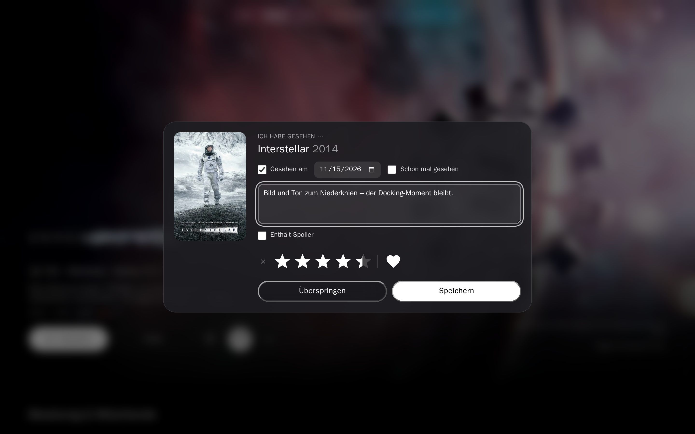
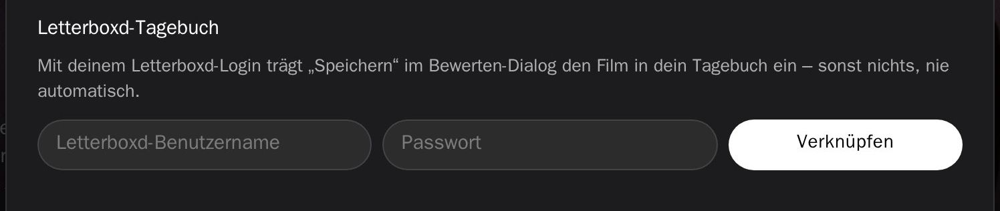
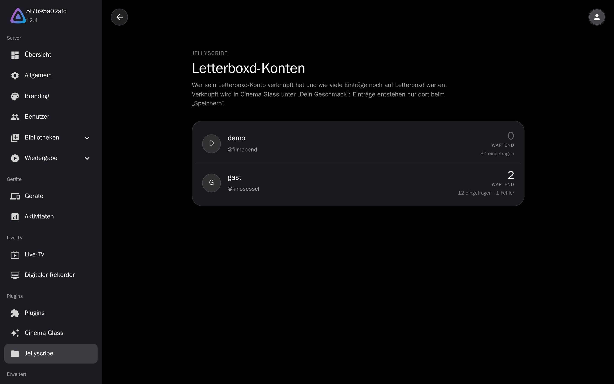
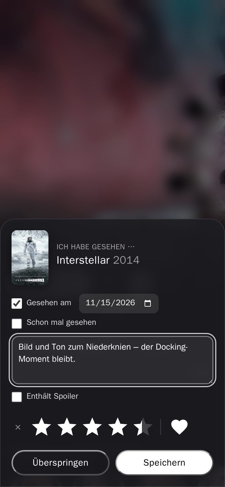

# Jellyscribe – Fork für Jellyfin 12.4

  
  
  
  
  

Ein Fork von [builtbyproxy/jellyfin-plugin-letterboxd](https://github.com/builtbyproxy/jellyfin-plugin-letterboxd) (MIT)
für **Jellyfin 12.4**. Er führt dein Letterboxd-Tagebuch nur auf Wunsch und arbeitet dafür mit dem Bewerten-Dialog von
[Cinema Glass](https://github.com/derpfiff/cinema-glass) zusammen.

## Was anders ist als im Original

- **Nichts automatisch.** Abspielen, Bewerten in Jellyfin, Favoriten und geplante Aufgaben schicken nichts an Letterboxd.
- **Nur bestätigte Einträge.** Nach dem Schauen fragt Cinema Glass nach Datum, halben Sternen, Herz, Kommentar und „schon mal gesehen“. Erst „Speichern“ trägt den Film ins Tagebuch ein. Wer später etwas ändert, ändert den vorhandenen Eintrag und legt keinen zweiten an.
- **Offline.** Ist Letterboxd gerade nicht erreichbar, wartet der Eintrag und wird nachgereicht.
- **Nur Filme.** Serien (Serializd) sind abgeschaltet und kommen in der Oberfläche nicht mehr vor.
- **Deine Bewertungen fließen zurück.** Alle Filme, die du auf Letterboxd bewertet, gemocht oder gesehen hast, liefert das Plugin an Cinema Glass. Dort gehen sie in die Empfehlungen ein.
- **Minimale Oberfläche.** Das Konto verknüpft jede Person selbst in Cinema Glass unter „Dein Geschmack“. Im Dashboard steht nur eine Übersicht: wer verknüpft ist und was noch wartet.

| | |
|---|---|
| **Konto verknüpfen** – in Cinema Glass unter „Dein Geschmack“  | **Übersicht für Admins** – Dashboard → Jellyscribe  |

## Installation

1. Dashboard → Plugins → Kataloge → hinzufügen, entweder
   `https://raw.githubusercontent.com/derpfiff/jellyfin-plugins/main/manifest.json` (gemeinsamer Katalog) oder
   `https://raw.githubusercontent.com/derpfiff/jellyscribe-fork/main/manifest.json` (nur dieses Plugin).
2. **Jellyscribe** installieren, Jellyfin neu starten.
3. In Cinema Glass: Entdecken → „Dein Geschmack“ → Letterboxd-Tagebuch → mit Letterboxd-Name und Passwort verknüpfen.

Das Passwort bleibt auf deinem Server. Wie das Original nutzt das Plugin dessen eingebaute Zugangsschlüssel für
Letterboxds Schnittstelle.

## Schnittstelle

Alle Aufrufe gelten für das angemeldete Konto.

| Adresse | Zweck |
|---|---|
| `GET /LetterboxdLog/Status` | eingeschaltet, eingerichtet, Anzahl wartender Einträge |
| `GET`/`POST`/`DELETE /LetterboxdLog/Account` | Konto ansehen, verknüpfen bzw. ein- und ausschalten, trennen |
| `POST /LetterboxdLog/Entry` | Tagebucheintrag aus dem Bewerten-Dialog (Datum, Sterne, Herz, Kommentar, Spoiler, erneut gesehen) |
| `GET /LetterboxdLog/Entries` | die eigenen Einträge und ihr Stand |
| `GET /LetterboxdLog/Ratings` | alles, was das verknüpfte Konto auf Letterboxd bewertet, gemocht oder gesehen hat (6 h zwischengespeichert) |
| `GET /LetterboxdLog/Overview` | Übersicht aller verknüpften Konten (Administratoren) |

## Bauen und veröffentlichen

`build.sh` baut gegen die Server-Bibliotheken von Jellyfin 12.4 in `lib/`. GitHub baut bei jedem Push gegen das offizielle
12.4-Image. Für eine neue Version die Version in `meta.json` anheben und den Tag `v<Version>` pushen: Der Ablauf
`release.yml` legt dann Release, Zip und Katalog an. Alle Änderungen gegenüber dem Original stehen in
[CHANGES-JELLYFIN-12.4.md](CHANGES-JELLYFIN-12.4.md). Die ursprüngliche Anleitung liegt unter
[docs/UPSTREAM-README.md](docs/UPSTREAM-README.md).

## Verwandte Projekte

- [Cinema Glass](https://github.com/derpfiff/cinema-glass): Oberfläche für Jellyfin mit Bewerten-Dialog und Empfehlungen
- [jellyfin-plugins](https://github.com/derpfiff/jellyfin-plugins): gemeinsamer Katalog
- [Original von builtbyproxy](https://github.com/builtbyproxy/jellyfin-plugin-letterboxd)

Dieses Projekt ist kein offizielles Angebot von Letterboxd oder Jellyfin.
